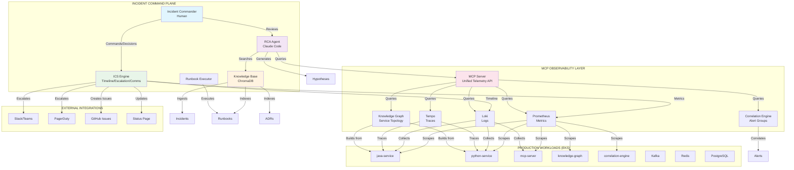
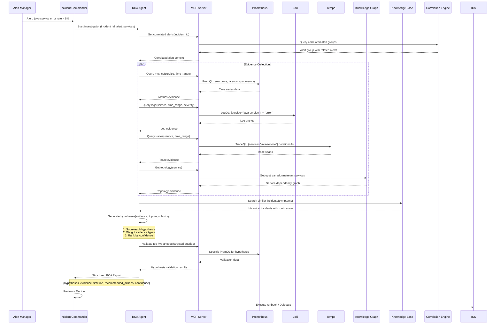
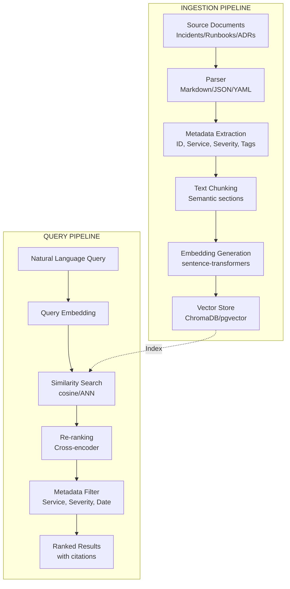
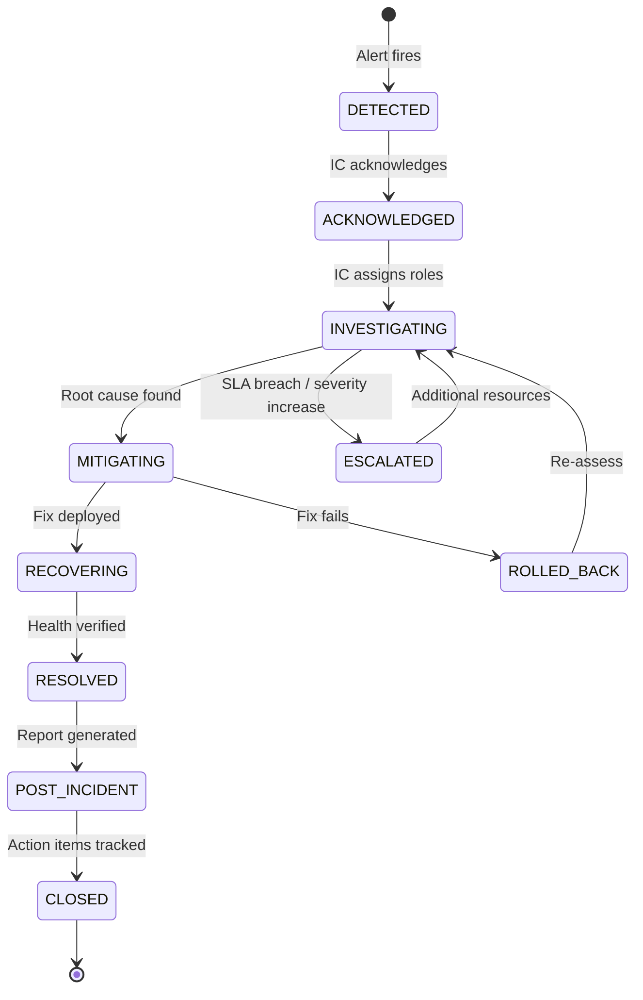
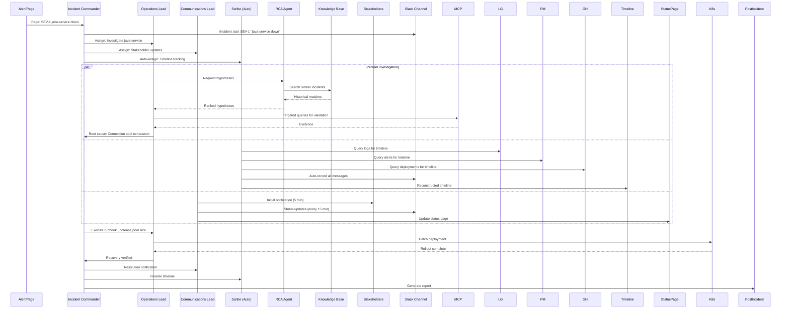
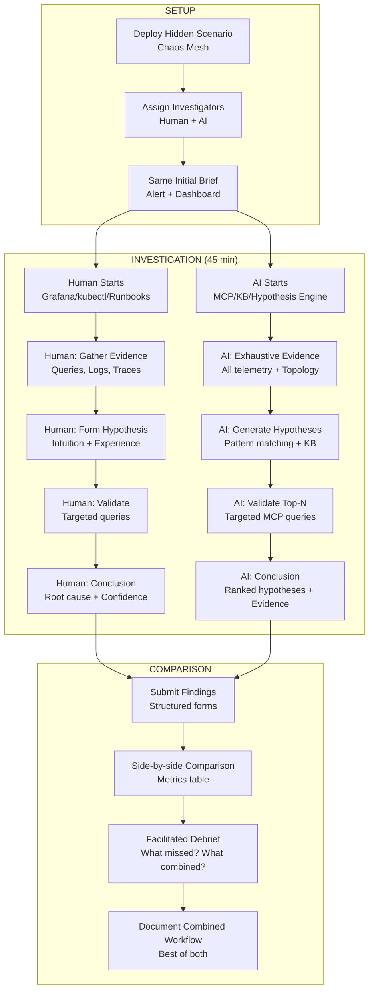
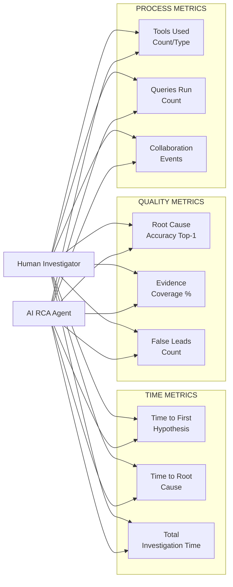
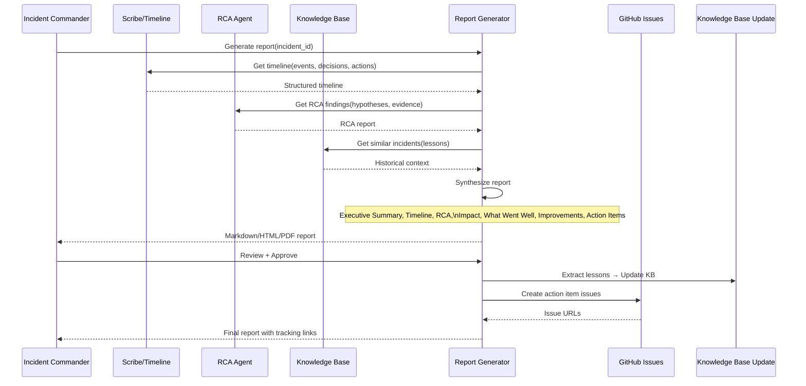
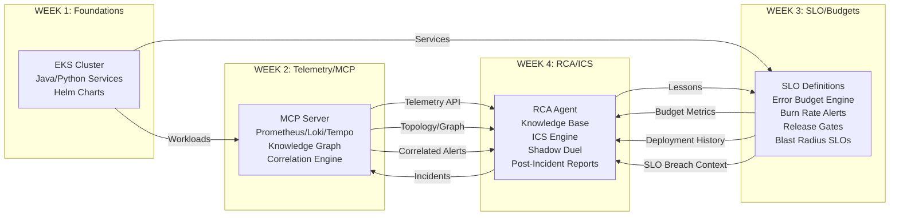
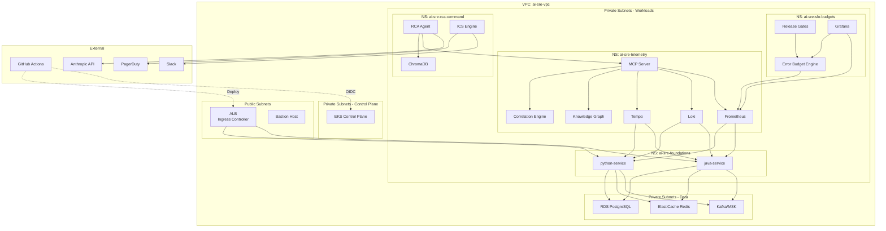

# Week 4 Architectural Flow: Agent RCA & Incident Command

> **Repository:** `ai-sre-rca-command`  
> **Focus:** Data flows, component interactions, and sequence diagrams for RCA agent and ICS

---

## 🏗️ System Architecture Overview



---

## 🔄 RCA Agent Investigation Flow



---

## 📊 Knowledge Base Ingestion & Query Flow



---

## 🚨 Incident Command System Flow



### ICS Role Interaction Flow



---

## 🥊 Shadow Duel Flow



### Shadow Duel Comparison Metrics



---

## 📈 Post-Incident Report Generation Flow



---

## 🔗 Week-to-Week Integration Points



---

## 🌐 Network & Security Architecture



---

## 📋 Component Specifications

### RCA Agent Deployment

```yaml
# lab-4-rca-command/rca-agent/values.yaml
replicaCount: 1
namespace: ai-sre-rca-command

image:
  repository: ai-sre/rca-agent
  tag: latest
  pullPolicy: IfNotPresent

resources:
  limits:
    cpu: 2000m
    memory: 2Gi
  requests:
    cpu: 500m
    memory: 1Gi

mcp:
  url: http://mcp-server.ai-sre-telemetry.svc.cluster.local:8082
  timeout: 30s

knowledgeBase:
  type: chroma
  url: http://chroma.ai-sre-rca-command.svc.cluster.local:8000
  collection: incidents

model:
  provider: anthropic
  name: claude-3-5-sonnet-20241022
  apiKeySecret: anthropic-api-key

rbac:
  create: true
  clusterRoles:
    - prometheus-query
    - loki-query
    - tempo-query

service:
  type: ClusterIP
  port: 8080
  healthPath: /health
  investigatePath: /investigate
```

### Knowledge Base (ChromaDB) Deployment

```yaml
# lab-4-rca-command/knowledge-base/chroma-values.yaml
persistence:
  enabled: true
  size: 10Gi
  storageClass: gp3

resources:
  limits:
    cpu: 1000m
    memory: 4Gi
  requests:
    cpu: 250m
    memory: 1Gi

service:
  type: ClusterIP
  port: 8000

env:
  - name: CHROMA_SERVER_HOST
    value: "0.0.0.0"
  - name: CHROMA_SERVER_PORT
    value: "8000"
  - name: ANONYMIZED_TELEMETRY
    value: "False"
```

### ICS Engine Configuration

```yaml
# lab-4-rca-command/incident-command/config.yaml
team: platform-team
timezone: UTC

escalation:
  sev1:
    - delay: 0
      role: incident_commander
      notify: [oncall-primary]
      action: page
    - delay: 300
      role: operations_lead
      notify: [service-owner]
      action: page
    - delay: 900
      notify: [team-lead, manager]
      action: page
  
  sev2:
    - delay: 0
      role: incident_commander
      notify: [oncall-primary]
      action: slack
    - delay: 900
      role: operations_lead
      notify: [service-owner]
      action: slack
    - delay: 1800
      notify: [team-lead]
      action: slack

communication:
  slack:
    webhook_secret: slack-webhook-url
    channel_template: "#incidents-{namespace}"
    update_cadence:
      sev1: 600
      sev2: 900
      sev3: 1800
  status_page:
    url: https://status.example.com/api
    api_key_secret: statuspage-api-key
  github:
    repo: ramkannans-labs/ai-sre-rca-command
    token_secret: github-token
    labels: [incident, auto-generated]

timeline:
  sources:
    - loki
    - prometheus_alerts
    - github_deployments
    - slack_messages
  loki_url: http://loki.ai-sre-telemetry.svc.cluster.local:3100
  prometheus_url: http://prometheus.ai-sre-telemetry.svc.cluster.local:9090
```

---

## 🎯 Data Flow Summary

| Flow | Source | Destination | Protocol | Frequency |
|------|--------|-------------|----------|-----------|
| Metrics scrape | Services | Prometheus | HTTP/PromQL | 15s |
| Log collection | Services | Loki | HTTP/LogQL | Continuous |
| Trace export | Services | Tempo | OTLP/gRPC | Continuous |
| MCP queries | RCA Agent | MCP Server | HTTP/REST | On-demand |
| MCP → Prometheus | MCP Server | Prometheus | HTTP/PromQL | On-demand |
| MCP → Loki | MCP Server | Loki | HTTP/LogQL | On-demand |
| MCP → Tempo | MCP Server | Tempo | HTTP/TraceQL | On-demand |
| MCP → Knowledge Graph | MCP Server | KG Service | HTTP/REST | On-demand |
| Knowledge Base ingest | Scripts | ChromaDB | HTTP/REST | Batch/On-demand |
| Knowledge Base query | RCA Agent | ChromaDB | HTTP/REST | On-demand |
| Timeline reconstruction | ICS Engine | Loki/Prometheus/GitHub | HTTP/REST | On incident |
| Escalation notifications | ICS Engine | Slack/PagerDuty | Webhook | On trigger |
| Post-incident report | Report Gen | GitHub Issues/Knowledge Base | HTTP/REST | On close |
| Shadow Duel metrics | Simulation | Prometheus | Pushgateway | Per exercise |

---

*All components deploy to AWS EKS. No GCP/Azure dependencies. All GitHub Actions use `workflow_dispatch` manual triggers only.*